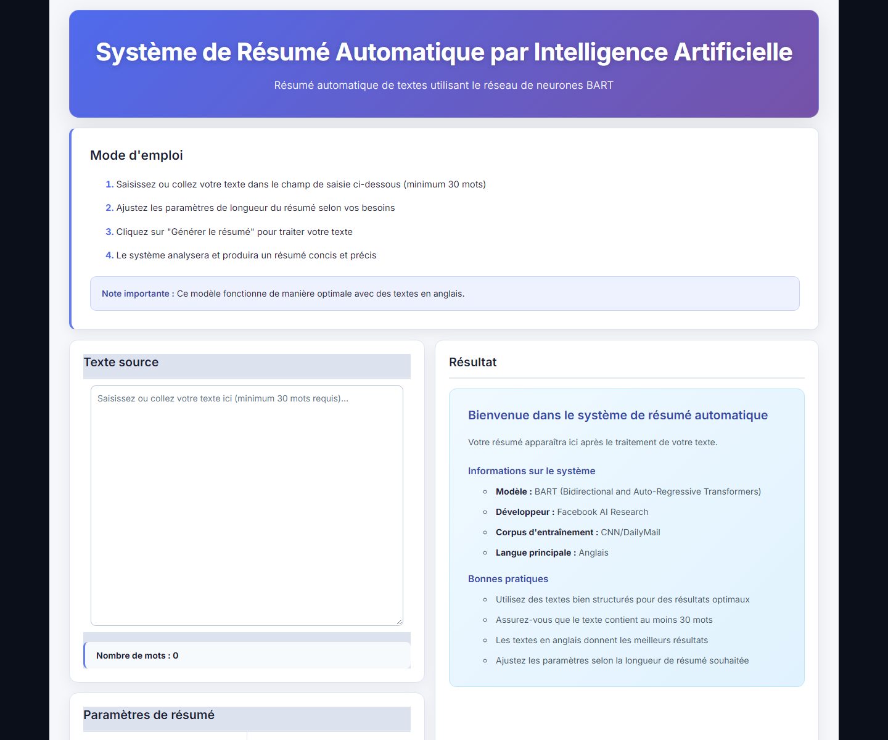
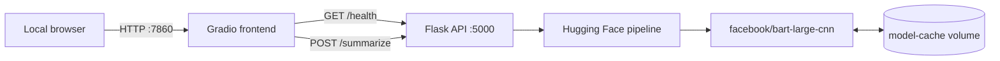

# Dockerized BART Text Summarizer

A containerized AI text summarization application built with Flask, Gradio, Hugging Face BART, and Docker Compose.

The project demonstrates how to package an AI inference service and a web interface as separate, reproducible containers. It is designed as a local portfolio project rather than a production platform.



## Features

- Abstractive text summarization with `facebook/bart-large-cnn`
- Responsive Gradio dashboard with word count and summary statistics
- Flask JSON API with readiness and summarization endpoints
- Validation for empty, short, oversized, and malformed inputs
- CPU-only PyTorch installation without CUDA/NVIDIA dependencies
- Persistent Hugging Face model cache
- Backend healthcheck and health-aware frontend startup
- Non-root containers and localhost-only port exposure
- Offline unit tests using a mocked Hugging Face pipeline

## Technology stack

| Layer | Technology |
| --- | --- |
| Frontend | Gradio 6.16.0, Gradio Client 2.5.0, Requests 2.32.3 |
| Web stack | FastAPI 0.162.0, Starlette 1.3.1, Jinja2 3.1.4 |
| Backend | Python 3.11, Flask 3.1.3, Werkzeug 3.1.9 |
| AI | Transformers 5.10.4, PyTorch 2.15.0 CPU, SentencePiece 0.2.2 |
| Model | `facebook/bart-large-cnn` |
| Platform | Docker, Docker Compose |
| Tests | pytest 8.3.5, Flask test client, mocks |

All direct Python dependencies are pinned in the service requirement files for reproducible builds.

## Architecture



Docker Compose creates a private network. The frontend reaches the API through the Docker DNS name `http://backend:5000`; it does not use `localhost` for inter-container traffic. Published ports bind to `127.0.0.1` and are not exposed publicly by default.

## Prerequisites

- Docker Desktop or Docker Engine with Docker Compose
- At least 4–6 GB of available RAM
- Several gigabytes of free disk space
- Internet access during the first model download
- Available local ports `5000` and `7860`

The first startup is slower because BART is downloaded and loaded into memory. Later starts reuse the named model cache.

## Run with Docker Compose

Clone the repository and enter its directory:

```bash
git clone <your-repository-url>
cd dockerized-bart-text-summarizer
```

Build and start both services:

```bash
docker compose up -d --build
```

Check their status:

```bash
docker compose ps
```

Open the application:

- Dashboard: <http://localhost:7860>
- Backend readiness: <http://localhost:5000/health>

Follow the logs:

```bash
docker compose logs -f
docker compose logs -f backend
docker compose logs -f frontend
```

Stop the application without deleting the model cache:

```bash
docker compose down
```

> Do not run `docker compose down -v` unless you intentionally want to delete the downloaded BART cache.

Windows helper scripts are also available:

```powershell
.\lancer.bat
.\arreter.bat
```

## Essential Docker commands

```bash
# Validate the Compose configuration
docker compose config

# Build one service only
docker compose build backend
docker compose build frontend

# Recreate one service without rebuilding its dependency
docker compose up -d --no-deps --force-recreate frontend

# Inspect service state and resource usage
docker compose ps
docker stats

# Stop containers while preserving the named volume
docker compose down
```

## API

### Readiness

```http
GET /health
```

### Summarization

```http
POST /summarize
Content-Type: application/json
```

Example body:

```json
{
  "text": "A source text containing at least thirty words...",
  "max_length": 130,
  "min_length": 30
}
```

Successful response:

```json
{
  "original_length": 120,
  "summary": "The generated summary...",
  "summary_length": 36
}
```

Requests are limited to 1 MiB and 1,024 BART tokens. Summary lengths must be integers between 10 and 500, and `min_length` cannot exceed `max_length`.

## Troubleshooting

- **`docker compose` is unavailable:** update Docker Desktop or install the current Compose plugin.
- **Port 5000 or 7860 is already in use:** stop the conflicting local process before starting the stack.
- **Backend takes several minutes to become healthy:** the first run downloads and loads the BART model; follow progress with `docker compose logs -f backend`.
- **Out-of-memory failure:** make at least 4–6 GB available to Docker Desktop and close other memory-intensive applications.
- **Frontend cannot reach the API:** confirm that `docker compose ps` reports the backend as healthy and that the frontend uses `http://backend:5000` inside Docker.
- **Rebuild only the changed UI:** run `docker compose build frontend` followed by `docker compose up -d --no-deps --force-recreate frontend`.

## Persistent model cache

The named volume `model-cache` is mounted at `/app/cache`. `HF_HOME` and `TRANSFORMERS_CACHE` point to this directory so model files survive container recreation and image rebuilds.

The model and cache are not stored in the repository or copied into either Docker build context.

## Run the tests

The unit tests do not download BART. They set `BART_SKIP_MODEL_LOAD=1` and inject a mock summarization pipeline.

From the repository root:

```bash
python -m venv .venv

# Linux/macOS
source .venv/bin/activate

# Windows PowerShell
.\.venv\Scripts\Activate.ps1

python -m pip install -r backend/requirements-dev.txt
python -m pytest backend/tests
```

The suite covers readiness, valid summarization, malformed JSON, invalid lengths, short and oversized inputs, and model exceptions.

## Docker and DevOps skills demonstrated

- Separate Dockerfiles and build contexts for frontend and backend
- Layer ordering that preserves dependency-installation cache
- CPU-specific PyTorch installation from the official PyTorch index
- Service discovery through Docker Compose DNS
- Healthcheck-driven startup dependencies
- Persistent named volumes for large model artifacts
- Explicit memory limits and shared-memory configuration
- Non-root container execution
- Localhost-only published ports
- `.dockerignore` files that minimize build contexts
- Reproducible pinned dependencies
- Automated tests that isolate the expensive AI dependency
- Operational validation through Compose, logs, health checks, and smoke tests

## Project structure

```text
.
├── .github/workflows/ci.yml
├── docs/
│   ├── README.md
│   ├── images/dashboard.png
│   └── technical/
├── backend/
│   ├── tests/
│   ├── .dockerignore
│   ├── Dockerfile
│   ├── app.py
│   ├── requirements.txt
│   ├── requirements-dev.txt
│   └── requirements-torch-cpu.txt
├── frontend/
│   ├── .dockerignore
│   ├── Dockerfile
│   ├── app.py
│   └── requirements.txt
├── docker-compose.yml
├── lancer.bat
├── arreter.bat
└── README.md
```

Complementary technical documentation is organized under [`docs/`](docs/README.md). The root README is the authoritative source for current installation, execution, architecture, and testing instructions.

## Security and limitations

- No credentials or API keys are required.
- Both services bind only to localhost.
- Containers run as an unprivileged user.
- Dynamic backend content is HTML-escaped before display.
- Internal exceptions are logged but not exposed to clients.
- The application has no authentication or TLS and is intended for local demonstration.
- The Flask development server is not intended for public production traffic.
- `facebook/bart-large-cnn` is primarily optimized for English.
- CPU inference is slower than GPU inference.

## License

No license has been selected yet. Add an appropriate open-source license before inviting external reuse or contributions.
